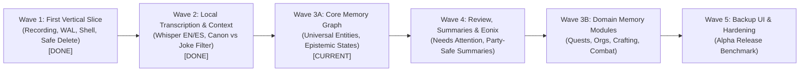

# Palantyr (V1 / V2)

> **Palantyr is the second memory of a DM.**  
> *The DM runs the game. Palantyr remembers it.*

Palantyr is a Windows-first, 100% offline-first Campaign Memory Keeper for Dungeon Masters and Game Masters of tabletop role-playing games (TTRPGs). It captures tabletop audio safely to progressive local disk segments, transcribes them locally in English (`en`) and Spanish (`es`), filters out-of-character banter and hypothetical jokes from campaign canon, maintains an epistemic Campaign Memory Graph across multi-month campaigns, and provides grounded retrieval and conversational teaching via **Eonix**, the DM's private memory dragon companion.

---

## Key Product Guarantees

1. **Zero Recording Loss ($\le 2\text{s}$ crash window)**: Active tabletop audio is written to disk every 2 seconds with an authoritative `session_recording.pseg` Write-Ahead Log (WAL) and automatic in-place 44-byte RIFF header repair upon crash reboot.
2. **Invisible by Design & Gameplay Priority**: Palantyr operates unobtrusively during play. Resource allocation strictly prioritizes audio capture and Eonix lookups over background processing, pausing deferrable AI workloads on systems under CPU/RAM/VRAM pressure.
3. **Strict Epistemic Isolation**: The system strictly separates what is true in the world (*Campaign Truth*), what the party believes (*Party Belief*), what rumors are circulating (*Claim / Rumor*), and private DM secrets (*DM Private Truth*).
4. **Local Sovereignty & Diagnostic Redaction**: Palantyr executes 100% locally on `127.0.0.1` loopback with zero external telemetry or cloud dependencies. Diagnostic logs redact transcripts and DM secrets automatically.

---

## Technology Stack

- **Host & Runtime**: `.NET 10` desktop host (`WebView2` shell + ASP.NET Core Minimal API loopback on `127.0.0.1:5178`).
- **Database & Graph Store**: `RavenDB Embedded` with strict database-per-campaign physical isolation (`Palantyr_System` + `Palantyr_Campaign_<Id>`), Voron scratch caps ($64\text{ MB}$), Corax multilingual full-text search, native HNSW vector index, and document revisions for historical auditability.
- **Frontend UI**: `React 19` + `TypeScript` + `Vite` with full bilingual English (`en`) and Spanish (`es`) localization, accessible status patterns (WCAG non-color-only), and reduced motion support.
- **Audio & WAL Engine**: `WASAPI` / `NAudio` progressive PCM recorder (16 kHz, 16-bit mono WAV), 15-minute automatic segment rollover, and 10-second audio clip slicer.
- **AI Adapters**: Provider-neutral adapter contracts (`ITranscriptionEngine`, `IContextClassifier`, `IMemoryExtractor`, `IEonixAssistant`) backed by local GGUF/C++ sidecars.

---

## Prerequisites

To build, test, and run Palantyr locally, ensure you have:

1. **Operating System**: Windows 10 (Build 19041+) or Windows 11.
2. **.NET SDK**: [.NET 10 SDK](https://dotnet.microsoft.com/download/dotnet/10.0) (or .NET 9+ preview).
3. **Node.js**: [Node.js 20 LTS+](https://nodejs.org/) (includes `npm`).
4. **Microphone**: An internal or USB microphone (for live audio recording and validation).

---

## Quick Start — How to Run & Try the App

### Step 1: Clone the Repository
```bash
git clone https://github.com/jmunozc023/PalantyrV0.2.git
cd PalantyrV0.2
```

### Step 2: Build the Solution & Run Automated Tests
Verify all architectural contracts, crash recovery mechanics, and privacy filters:
```powershell
# Restore and build the .NET 10 solution
dotnet build Palantyr.sln

# Run the full vertical slice test suite
dotnet test Palantyr.sln
```
All 8 test suites in `Wave1VerticalSliceTests.cs` should execute and pass cleanly.

---

### Step 3: Start the Backend Host API
The backend exposes the loopback REST endpoints on `http://127.0.0.1:5178`:
```powershell
dotnet run --project src/Palantyr.Host
```
You will see:
```text
[Palantyr.Host] Starting Palantyr Host on http://127.0.0.1:5178...
[Palantyr.Host] Embedded RavenDB initialized at <AppDataLocal>\Palantyr\Storage
[Palantyr.Host] System loopback ready.
```

---

### Step 4: Start the React Frontend UI
In a separate terminal window, navigate to the UI directory and launch Vite:
```powershell
cd src/palantyr-ui
npm install
npm run dev
```
Open your browser at **`http://127.0.0.1:5173`**.

---

## Interactive Feature Walkthrough (What You Can Try)

When running the application, you can test and experience the complete Wave 1 vertical slice:

### 1. First-Run System Assessment & Hardware Profile
- Click **"System Assessment"** in the top navigation bar.
- The system evaluates your CPU cores, RAM, GPU/VRAM, and storage, testing your default microphone signal and recommending a safe processing mode (`Live Balanced`, `Recording Only`, or `Manual / Deferred`) with bilingual rationales.

### 2. Guided Campaign Creation Wizard (6 Steps)
- Click **"Create New Campaign"** on the Welcome screen.
- Experience the 6-step guided wizard:
  1. **Basics**: Campaign name and subtitle.
  2. **World Setting**: Setting description and world summary.
  3. **Calendar**: In-world calendar format (e.g., Harptos, Imperial, or Relative Journey Days).
  4. **Initial Party**: Add characters with player-vs-character separation and role.
  5. **World Lore**: Ingest initial lore with visibility tags (`General World`, `Party Known`, or `DM Private`).
  6. **Audio Setup**: Test microphone and review campaign summary before creation.

### 3. Campaign Home & Explicit Subsystem Status Cards
- Open a campaign to access the persistent **Campaign Home**.
- Inspect the **4 distinct subsystem cards** for:
  - 🎙️ **Audio Recording & Save**
  - 📝 **Transcription**
  - 🧠 **Memory Processing**
  - 🐉 **Eonix / Query**
- Indicators use explicit geometric patterns (`hatch-lines`, `grid-dots`, `stipple`) and text badges, ensuring full accessibility without relying on color alone (`WCAG 1.4.1`).

### 4. Live Session Recording, Pause, Resume & End
- Click **"Start Recording Session"** to initialize progressive disk writing.
- Watch the elapsed session timer and segment counter update.
- Audio is flushed to disk every 2 seconds with `FileOptions.WriteThrough`.
- Click **"Pause"** to safely close the active segment (`ClosedSafe`) without blocking play.
- Click **"Resume"** to immediately open the next segment.
- Click **"End Session"** to trigger the **Two-Stage End Session Modal**:
  - Stage 1: Explicit confirmation preventing accidental closure.
  - Stage 2: Summary of recorded duration and segments, with the choice to `Continue Processing Now` or `Finish Later`.

### 5. Crash Recovery Simulation
- Click **"Simulate Crash Recovery"** in the navigation bar to test power-loss resilience.
- The engine scans the `session_recording.pseg` WAL, detects unclosed WAV files, repairs the 44-byte RIFF header in-place, and displays the **Crash Recovery Transparency Dialog** showing recovered audio duration and segment status.

### 6. Active Recording Window Close Interception Guard
- While a recording session is active, click **"Attempt Window Close"**.
- `WindowCloseGuardService` prevents silent data loss and requires the DM to choose between **"End Session and Exit"** or **"Return to Session"**.

### 7. Safe Campaign Deletion & `.palantyr-backup` Export
- From the Welcome screen, click the trash icon on any campaign card.
- Safe Deletion presents three explicit options:
  - **Create Backup and Delete**: Generates a timestamped `.palantyr-backup` ZIP container with SHA-256 manifest before dropping the database.
  - **Delete Without Backup**: Requires typed confirmation.
  - **Cancel**: Aborts safely.

### 8. Bilingual Language Toggle & Accessibility
- Click the language selector (`EN` / `ES`) in the header to switch the entire application between English and Spanish in real-time.
- Open **Settings** to toggle **"Reduce Animations"** (`WCAG 2.3.3`), which smoothly disables motion and breathing effects on the Eonix dragon avatar.

---

## Solution Architecture & Repository Layout

```text
PalantyrV0.2/
├── Palantyr.sln                     # .NET 10 solution root
├── Directory.Build.props            # Central compiler properties (net10.0, Nullable, C# 13)
├── src/
│   ├── Palantyr.Contracts/          # DTOs, Enums, Adapter Interfaces (Zero external dependencies)
│   ├── Palantyr.Domain/             # Memory models, epistemic states, store interfaces
│   ├── Palantyr.Audio/              # WASAPI capture, 2s flush, .pseg WAL, RIFF repair, watchdog
│   ├── Palantyr.Data.Raven/         # RavenDB Embedded, tenant isolation, PartySafe projections, backup
│   ├── Palantyr.AI.Orchestration/   # Single-GPU mutex, runtime priority scheduler, system assessment
│   ├── Palantyr.Host/               # ASP.NET Core loopback API (127.0.0.1:5178), WindowCloseGuard, redactor
│   └── palantyr-ui/                 # React 19 + TypeScript + Vite bilingual frontend
│       ├── src/
│       │   ├── components/          # EonixCompanionCard, SubsystemStatusBar, Wizard, Modals
│       │   ├── i18n/                # translations.ts (complete EN/ES dictionary >1200 keys)
│       │   ├── types/               # palantyr.ts (TypeScript contracts matching C# DTOs 1:1)
│       │   └── styles/              # palantyr.css (dark theme, patterns, WCAG contrast)
│       └── vite.config.ts           # Offline local proxy configuration
├── tests/
│   └── Palantyr.UnitTests/          # xUnit test suite (Wave 1 vertical slice & guardrail tests)
└── docs/
    ├── PALANTYR_V1_EPICS_AND_USER_STORIES.md    # Product backlog (52 stories, 12 EPICs)
    ├── PALANTYR_V1_ARCHITECTURE_AND_ADRS.md     # Architecture decisions (ADR-001..010)
    └── WAVE_1_WORK_UNIT_MANIFEST.md             # Work-unit manifest and quality gates
```

---

## Roadmap & Wave Delivery Progression



---

## License

Palantyr is licensed under the MIT License. Designed for Dungeon Masters who value local privacy, zero data loss, and uninterrupted storytelling.
