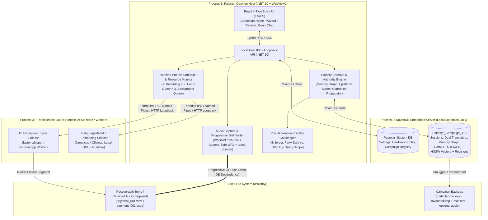

# Palantyr V1 — System Architecture & Technical Design v0.1 (`EPIC-00`)

> **Status**: Approved v1.0 (`Kaede` `MAP` / `ADR` / `ALT` Review: **PASS** with 4 Structural Guardrails Integrated)  
> **Confirmed Stack Baseline**: **.NET 10** + **RavenDB Embedded** + **React (TypeScript) via WebView2**  
> **Languages**: Bilingual **English (`en`) & Spanish (`es`)** across Transcription, UI, Prompts, and Eonix  
> **Reference Documents**: [PALANTYR_V1_EPICS_AND_USER_STORIES.md](file:///f:/PalantyrV2/docs/PALANTYR_V1_EPICS_AND_USER_STORIES.md) | Frozen PRD v1.0 - FINAL (Sections 1–42)

---

## 1. Architecture Map (`MAP`) — Module Boundaries & Ownership

### 1.1 High-Level Process & Component Topology

To satisfy `NFR-REL-001` (Recording Reliability), `NFR-REL-004` (Processing Failure Isolation), and `NFR-PERF-001..003` (Invisible by Design & Strict Resource Priority), Palantyr separates **in-process critical session operations** from **fault-isolated AI/ML worker processes**:



### 1.2 Strict Module Ownership & Dependency Direction

| Module / Assembly | Responsibility | Allowed Dependencies | Forbidden Coupling |
| :--- | :--- | :--- | :--- |
| `Palantyr.Contracts` | Provider-neutral DTOs, Enums (`KnowledgeState`, `ConfidenceLevel`, `ConversationContextType`, `VisibilityScope`), Adapter interfaces (`ITranscriptionEngine`, `IContextClassifier`, `IMemoryExtractor`, `IEonixAssistant`), Lineage metadata | None (Zero external dependencies) | Must NEVER reference `RavenDB`, `NAudio`, `faster-whisper`, or `Ollama` types (`ARCH-CONSTRAINT-002`). |
| `Palantyr.Domain` | Universal Memory entities, domain invariants, state transitions, entity resolution rules, conflict detection, quest feasibility math, crafting derivation rules, correction propagation logic | `Palantyr.Contracts` | Must NEVER perform direct I/O, audio capture, or raw LLM HTTP calls. |
| `Palantyr.Audio` | Microphone validation (`FR-REC-001`), WASAPI capture, progressive disk writer (`NFR-REL-006`), ~15–20 min segment rollover (`FR-REC-004`), crash recovery scanner (`FR-REC-006`), disk space monitor (`NFR-DATA-003`), 10s clip slicer (`FR-VAL-002`) | `Palantyr.Contracts`, `NAudio` / Windows Audio APIs | Must NEVER depend on `RavenDB` or AI sidecars to write or flush active audio bytes. |
| `Palantyr.Data.Raven` | `RavenDB.Embedded` lifecycle, per-campaign database provisioning, static Corax/Vector indexes, **Mandatory Visibility Query Gatekeeper** (`PartySafeQuerySession`), document revisions, `.ravendbdump` backup/restore | `Palantyr.Contracts`, `Palantyr.Domain`, `RavenDB.Embedded`, `RavenDB.Client` | Must NEVER allow unscoped queries from `PartySafe` callers to bypass `VisibilityScope.PartyKnown`. |
| `Palantyr.AI.Orchestration` | Priority scheduler (`FR-PERF-001`), persistent job queue (`FR-TRN-002`), prompt/schema registry & versioning (`NFR-MAINT-005`), replaceable adapter implementations | `Palantyr.Contracts`, `Palantyr.Domain` | Must NEVER write directly to Campaign Memory without passing through `Palantyr.Domain` authority & rejection-tombstone validation (`NFR-MAINT-008`). |
| `Palantyr.Host` | `.NET 10` Windows desktop shell (`WebView2`), hardware assessment (`FR-SYS-001..005`), window-close guard (`NFR-REL-009`), redacted structured logging (`NFR-PRIV-006`) | All backend modules | UI state must not hold unpersisted audio or unpersisted review decisions. |
| `palantyr-ui` (React/TS) | Bilingual (`en`/`es`) UI, Campaign Home, Guided Setup Wizard, Eonix Chat, Needs Attention Scroll View, Full Review Chronicle View, Memory Browser, Settings | Typed API client to `Palantyr.Host` | Zero direct internet calls; zero direct database or filesystem access. |

---

## 2. Alternatives Analysis (`ALT`) — Key Technical Tradeoffs

### 2.1 Desktop UI Host for `.NET 10 + React`
| Option | Memory Overhead | Windows Integration | DX & Maintainability | Verdict |
| :--- | :--- | :--- | :--- | :--- |
| **A. .NET 10 Native Window (WinUI 3 / WPF) + WebView2 hosting React SPA** | **Low (~80–130 MB)** (shares OS Edge WebView2 runtime) | **First-class** (direct C# access to WASAPI, DXGI, NVML, window close interception `NFR-REL-009`) | High (Vite + React + TS frontend; ASP.NET Core Kestrel loopback or WebView2 bridge) | **SELECTED (`ADR-001`)** |
| **B. Electron + .NET 10 Sidecar** | High (~300–500 MB duplicate Chromium + Node) | Indirect (requires IPC for audio/window lifecycle) | Two full packaging pipelines | Rejected (violates `NFR-PERF-001` resource austerity) |
| **C. Blazor Hybrid (Razor instead of React)** | Low | First-class | Loses React ecosystem requested by user | Rejected |

### 2.2 RavenDB Embedded Topology: Single DB vs. Database-per-Campaign
| Option | Backup / Restore (`NFR-DATA-008`) | Campaign Deletion (`NFR-DATA-010`) | Cross-Campaign Leak Risk | Verdict |
| :--- | :--- | :--- | :--- | :--- |
| **A. One RavenDB Database per Campaign (`Palantyr_Campaign_<Id>`) + `Palantyr_System` DB** | **Native & Atomic**: RavenDB Smuggler exports/imports a single campaign DB directly | **Clean**: Export backup if requested, then drop campaign DB & folder | **Zero**: Queries and vector indexes are physically isolated per campaign | **SELECTED (`ADR-002`)** |
| **B. Single Global RavenDB Database with `CampaignId` property on all documents** | Requires custom filtered export/import logic and manual index reconstruction | Requires bulk delete query across all collections; risks orphaned documents | Missing `Where(x => x.CampaignId == id)` leaks lore across campaigns | Rejected |

---

## 3. Architecture Decision Records (`ADR`) — Resolving PRD Section 41

### ADR-001: .NET 10 + WebView2 + React (Bilingual EN/ES) Application Stack
- **Context**: Resolves `TECH-DECISION (Windows application stack/framework and packaging strategy)` and user directive for `.NET 10 + React + EN/ES`.
- **Decision**:
  - Build a `.NET 10` Windows desktop host embedding Microsoft Edge `WebView2` to render a bundled **React 19 + TypeScript + Vite** frontend.
  - Communication between React and `.NET 10` uses a local-only loopback API (`127.0.0.1` ephemeral port with per-launch session token) plus Server-Sent Events (SSE) / SignalR for real-time subsystem status indicators (`UX-HOME-004`).
  - Internationalization (`i18n`) uses `i18next` in React and resource dictionaries / prompt templates in `.NET 10`, supporting **English (`en`) and Spanish (`es`)** at both UI level and Campaign language level (`FR-TRN-003`).
- **Consequences & Rollback**: Minimal RAM footprint during active VTT sessions; if `WebView2` ever requires debugging outside the desktop shell, the exact same React UI can open in a local browser during development.

### ADR-002: RavenDB Embedded with Per-Campaign Isolation & Active-Session Throttling
- **Context**: Resolves `TECH-DECISION (Local database/storage technology, concrete schema, and retrieval architecture)` using the user's selected **RavenDB** engine while strictly enforcing `NFR-PERF-001..003` (Invisible by Design) and `NFR-REL-001` (Recording Reliability).
- **Decision**:
  1. **Embedded Local Server**: Run `RavenDB.Embedded` bound strictly to `127.0.0.1` (no external network port exposure).
  2. **Database Topology**:
     - `Palantyr_System`: Stores `SystemAssessmentProfile`, `AppSettings`, `InstalledModelRegistry`, and `CampaignCatalogEntry` metadata.
     - `Palantyr_Campaign_<CampaignId>`: One dedicated database per campaign. Only the **currently active campaign database** is kept loaded in memory; inactive campaign databases remain unloaded on disk.
  3. **Resource & Indexing Caps (Critical Guardrail — `Kaede Finding 2`)**:
     - Configure RavenDB Embedded options for desktop coexistence: set `Storage.MaxScratchBufferSizeInMb = 64`, `Memory.LowMemoryCommitLimitInMb = 256`, `Indexing.MaxNumberOfConcurrentlyRunningIndexes = 1`, and automatically unload inactive `Palantyr_Campaign_<Id>` databases when switching campaigns (`Databases.MaxIdleTimeForTenantDatabaseInSec`). Use **Corax** for multilingual (`en`/`es`) full-text and **native HNSW vector indexing** in RavenDB.
     - **Active Recording Throttle**: When `SessionState == Recording`, the Priority Scheduler sets non-essential background RavenDB batch writes (Memory extraction batches, bulk vector re-indexing) to paused/throttled, allowing only read-only `Talk to Eonix` queries (`FR-PERF-001`) and closed-segment ingestion.
  4. **Document Revisions for Auditability**: Enable RavenDB Document Revisions on `MemoryEntity`, `SessionSummary`, and `TranscriptSegment` collections so every DM correction or state transition retains an immutable historical audit trail (`FR-COR-002`, `FR-MEM-CONFLICT-004`).
- **Consequences & Rollback**: Gives Palantyr native document flexibility, graph-like `Include()` traversals, full-text + vector hybrid retrieval, and native per-campaign `.ravendbdump` backups in a single engine. Repository interfaces (`ICampaignMemoryStore`, `ISessionStore`) remain inside `Palantyr.Domain` so storage mechanics never leak into business rules.

### ADR-003: Crash-Safe Progressive Audio Capture & Authoritative `.pseg` WAL (Zero-DB Recording Path)
- **Context**: Resolves `TECH-DECISION (Concrete progressive audio write/buffering strategy and measurable crash-loss target)` and `NFR-REL-001`, `NFR-REL-006`, `NFR-DATA-001..003`.
- **Decision**:
  1. **`session_recording.pseg` is the Sole Authoritative Write-Ahead Log (WAL) During Active Recording (`Kaede Finding 1`)**: Active audio and segment state are written strictly to `<AppDataLocal>\Palantyr\Campaigns\<CampaignId>\Sessions\<SessionId>\Audio\` with zero dependency on RavenDB during active recording to prevent split-brain states on power loss.
  2. **Progressive Flush Protocol (`<= 2s` Loss Window)**:
     - Capture microphone input via `WASAPI` (`NAudio`) into a ring buffer.
     - Every **2 seconds**, flush PCM frames (`16 kHz, 16-bit mono WAV` for speech recognition + review playback) to `segment_NNN.wav` with `FileOptions.WriteThrough` (or explicit `Flush(flushToDisk: true)`) and update the append-only journal `session_recording.pseg` containing `(SegmentId, StartUtc, LastFlushedBytes, LastFlushedDurationMs, Status)`.
  3. **Automatic ~15-Minute Segment Rollover & Pause Closure (`FR-REC-004..005`)**:
     - At 15 minutes (or when the DM clicks `Pause` or `End Session`), finalize the WAV header size bytes for `segment_NNN.wav`, mark it `ClosedSafe` in `session_recording.pseg`, and immediately open `segment_NNN+1.wav` without dropping frames. Closed segments are then asynchronously synced to RavenDB from `.pseg`.
  4. **Deterministic Startup Reconciliation Protocol (`FR-REC-006..008`, `Kaede Finding 1`)**:
     - On application startup, `CrashRecoveryScanner` inspects all `session_recording.pseg` journals BEFORE loading campaign UI. If an unclosed `Active` segment exists, it calculates actual PCM data length on disk, repairs the 44-byte RIFF/WAV header in-place, marks it `RecoveredFromCrash` in `.pseg`, and idempotently reconciles/upserts `SessionDocument` and `AudioSegmentRecord` into `Palantyr_Campaign_<Id>` before presenting the Recovery Transparency dialog (`FR-REC-007..008`).
  5. **Storage Exhaustion Watchdog (`NFR-DATA-003`)**:
     - Poll available disk space every 10 seconds during recording. Warn at `< 2 GB` free (`Needs Warning`) and gracefully pause/close segment before `< 250 MB` free so Palantyr never reports a false healthy `Recording` state when writes fail.

### ADR-004: Universal & Domain Memory Schema in RavenDB
- **Context**: Resolves `TECH-DECISION (Concrete Memory representation for entities, facts, statements, events, relationships, temporal validity, visibility, confidence, and provenance)`.
- **Decision**:
  Every Campaign Memory document in `Palantyr_Campaign_<Id>` inherits or composes the **Universal Memory Envelope**, and every embedded sub-item (claim, historical state, relationship edge, upgrade, objective) carries its own explicit `VisibilityScope` (`Kaede Finding 3`):
  ```csharp
  public abstract record MemoryDocumentBase
  {
      public required string Id { get; init; } // e.g., "characters/tjuv-01", "quests/great-mine-01"
      public required MemoryEntityType EntityType { get; init; }
      public required string CanonicalName { get; set; }
      public List<string> Aliases { get; init; } = [];          // In-world lore aliases/nicknames (FR-MEM-CHAR-001)
      public List<string> Titles { get; init; } = [];           // In-world titles
      public List<string> RecognitionVariants { get; init; } = []; // Internal STT variants ONLY (FR-MEM-CHAR-002)
      public required VisibilityScope Visibility { get; set; }  // PartyKnown | DMPrivate | CharacterScoped
      public List<string> AuthorizedCharacterIds { get; init; } = []; // For FR-MEM-SOC-008 Limited Knowledge
      public required KnowledgeState KnowledgeState { get; set; } // CampaignTruth | DMPrivateTruth | PartyBelief | Theory | ClaimOrRumor | UnknownOrUnresolved | DisprovenBelief
      public required ConfidenceLevel Confidence { get; set; }  // DMConfirmed | High | Medium | LowOrUncertain
      public double InternalConfidenceScore { get; set; }       // 0.0 - 1.0 operational score (FR-MEM-CONF-008)
      public FirstAppearanceRef? FirstAppearance { get; init; }
      public List<ProvenanceRef> Sources { get; init; } = [];   // SessionId, SegmentId, SpanId, TimestampRange, SourceType
      public ProcessingLineage? Lineage { get; set; }           // Engine, ModelId, PromptVersion, SchemaVersion (ARCH-CONSTRAINT-003)
  }
  ```
  - **Historical State & Beliefs (`FR-MEM-KNOW-001`, `FR-MEM-OBJ-009..014`, `FR-MEM-ORG-005..006`)**: Each entity embeds a chronological `StateHistory` and `BeliefHistory` ledger (recording `Visibility`, `ValidFromSessionId`, `ValidToSessionId`, `RelativeTimeContext`, `SupersededByFactId`, `ChangeCauseEventId`) so historical queries (*"What did the party believe about M before they learned they were wrong?"*) can be answered deterministically without reconstructing old database snapshots.
  - **Model-Upgrade-Resilient Rejection & Resolution Tombstones (`FR-CTX-008`, `FR-REV-015`, `NFR-MEM-003`, `Kaede Finding 4`)**: A dedicated `MemoryResolutionTombstone` collection keys rulings on `(SessionId, SegmentId, ApproximateTimeWindowMs, NormalizedFactSignature, TargetEntityIds, DmDecision: RejectedAsNonCanon | RejectedAsFalse | MergedIntoEntityId)` rather than brittle raw text hashes, and treats human-confirmed `WorkingSpans` as sticky overlays aligned by timestamp overlap (`±2500 ms`) when `MachineUtterances` are re-transcribed after a model upgrade.

### ADR-005: Dual Transcript Layer & Span-Level Conversation Context Classification
- **Context**: Resolves `TECH-DECISION (Conversation Context classification implementation)` and `FR-CTX-001..010`, `FR-COR-002`.
- **Decision**:
  1. **Dual Transcript Representation (`TranscriptSegmentDocument`)**:
     - Each segment stores `MachineUtterances` (immutable array of `{ UtteranceId, StartMs, EndMs, OriginalText }` plus `TranscriptionLineage`) AND `WorkingSpans` (mutable array of `{ SpanId, StartMs, EndMs, CorrectedText, ContextClassification, ContextConfidence, ContextResolutionProvenance }`).
  2. **Two-Stage Context Classifier (`IContextClassifier`)**:
     - **Stage 1 (Fast Deterministic Heuristics + Roster Signals)**: Flags obvious meta/rules keywords (dice rolls, mechanic terms in EN/ES) and explicit DM quick-marks (`UX-CTX-002`).
     - **Stage 2 (Local Structured-Output LLM Pass)**: Classifies contiguous spans with sliding window context into `InWorldCanonCandidate`, `OutOfCharacterTableTalk`, `HypotheticalOrJoke`, `RulesOrMeta`, or `Ambiguous`, specifically detecting **Joke-to-Canon Transitions** (`FR-CTX-006`) where a DM statement ratifies a prior joke.
     - Only `InWorldCanonCandidate` spans (and DM-confirmed `Ambiguous` spans) feed the `IMemoryExtractor` and `ISessionSummaryGenerator` pipelines.

### ADR-006: Pre-Generation Visibility Gatekeeper & Sub-Collection Projection (`PartySafeMemoryView`)
- **Context**: Resolves `FR-SUM-001..005`, `NFR-PRIV-002..003` (*"Party Safe output must filter unauthorized sources before generation, not generate from all Memory and attempt to redact afterward"*).
- **Decision**:
  - Introduce a strongly-typed C# capability token `QueryVisibilityContext` required by all RavenDB retrieval methods used by `ISessionSummaryGenerator` and `IEonixAssistant`.
  - Split read models in `Palantyr.Contracts` into `PartySafeMemoryView` and `DmFullMemoryView` (`Kaede Finding 3`).
  - When `Mode == SummaryVisibilityMode.PartySafe` (or Eonix scope is `PartyKnowledge`), the RavenDB query builder applies both a server-side document filter (`WHERE Visibility == 'PartyKnown' AND KnowledgeState != 'DMPrivateTruth'`) AND a server-side RavenDB projection/transform that strips any sub-collection element (`StateHistory`, `BeliefHistory`, `Relationships`, `HiddenProperties`, `Objectives`, `Hierarchy`) whose item-level `Visibility != 'PartyKnown'` before DTO hydration.
  - Any record or sub-item with `Visibility == Unknown/Ambiguous` is excluded by default (`FR-SUM-005`).

### ADR-007: Hybrid Retrieval Architecture for Talk to Eonix
- **Context**: Resolves `TECH-DECISION (Retrieval architecture)` and Sections 14, 32, 33.
- **Decision**:
  Combine three native capabilities inside the per-campaign RavenDB database:
  1. **Exact & Alias/Variant Entity Lookup**: Corax index matching `CanonicalName`, `Aliases`, `Titles`, and `RecognitionVariants` (`FR-MEM-CHAR-001..002`).
  2. **Relational & Temporal Graph Traversal**: RavenDB `Include()` queries across `ParentLocationId`, `ParentEventId` (Journeys / Relative Days `FR-MEM-TIME-002`), `QuestId`, and `RelationshipEdges`.
  3. **Bilingual Semantic + Full-Text Search**: Multilingual (`en`/`es`) Corax BM25 full-text search combined with RavenDB native HNSW vector search over `MemoryClaims`, `SessionSummaries`, `PartyConversations`, and `TranscriptSegment.WorkingSpans`.
  - **Strict Grounding Contract (`FR-EONIX-013`)**: Eonix's system prompt and structured response schema require every factual assertion in a response to cite one or more retrieved `SourceIds` (`MemoryDocumentId` or `TranscriptSpanId`). If retrieval returns zero supporting documents above threshold, Eonix deterministically answers that the information is unknown/unrecorded.

### ADR-008: Replaceable AI Sidecar Architecture, Single-GPU Mutex & Model Promotion Gate
- **Context**: Resolves `ARCH-CONSTRAINT-001..005`, `TECH-DECISION (Production transcription & local model architecture)`.
- **Decision**:
  - **Transcription Adapter (`ITranscriptionEngine`)**: Default V1 implementation uses an out-of-process worker wrapping `faster-whisper` / `whisper.cpp` (supporting `whisper-large-v3-turbo` for GPU profiles and quantized `ggml-base/small/medium` for CPU fallback `FR-SYS-002`) with bilingual `en`/`es` timestamped utterance output.
  - **Memory & Eonix LLM Adapter (`ILanguageModelAdapter`)**: Default V1 implementation connects to a managed local `llama.cpp` / `Ollama` sidecar enforcing JSON-schema constrained decoding for extraction (`IMemoryExtractor`) and context classification (`IContextClassifier`).
  - **Single-Active-GPU-Worker Mutex (`Kaede Finding 2`)**: On `< 12 GB VRAM` hardware profiles (`Live Balanced` / `Recording Only`), `PriorityScheduler` enforces a strict mutex so Whisper transcription and LLM inference never hold concurrent active GPU allocations during `Recording`, preventing GPU VRAM paging while the DM's 3D VTT is running.
  - **Candidate-to-Default Gate (`ARCH-CONSTRAINT-004`)**: Model definitions live in a versioned manifest; new models run in `Candidate` mode against the `ARCH-CONSTRAINT-005` benchmark fixture corpus before promotion, with instant config rollback to the previous `KnownGood` model revision.

### ADR-009: Per-Campaign Backup Container (`.palantyr-backup`) & Migration Safety
- **Context**: Resolves `TECH-DECISION (Backup container format, migration/versioning rules, integrity verification, and restore transaction strategy)` and `NFR-DATA-004..011`.
- **Decision**:
  - A Campaign Backup is a standard ZIP archive with extension `.palantyr-backup` containing:
    1. `manifest.json`: Schema version, Palantyr app version, Campaign metadata, SHA-256 checksums, privacy warning flag (`NFR-PRIV-007`), and `IncludesRetainedAudio` boolean (`NFR-DATA-007`).
    2. `campaign.ravendbdump`: Complete RavenDB Smuggler export of `Palantyr_Campaign_<Id>` (documents + revisions).
    3. `audio/` (optional): Included ONLY if the user explicitly checks `Include Retained Audio` (`AC-DATA-007`).
  - **Safe Restore & Upgrade Migration (`NFR-DATA-004`)**: Restoring or migrating a campaign always imports/migrates into a staging database `Palantyr_Campaign_<Id>_Staging`, verifies SHA-256 and document counts, and only swaps it active after validation succeeds—preserving the last known-good state if interrupted (`NFR-REL-008`).

### ADR-010: Hardware Assessment, Priority Scheduler & Redacted Diagnostics
- **Context**: Resolves `TECH-DECISION (Hardware benchmark suite, resource-monitoring/throttling thresholds, and diagnostic/logging design)` and Sections 27, 29, 39.
- **Decision**:
  1. **First-Run Assessment (`FR-SYS-001..005`)**: Queries Windows `DXGI` / `NVML` / `WMI` for CPU cores/AVX2, system RAM, dedicated GPU VRAM, disk free space/SSD type, and WASAPI audio input devices, running a 5-second synthetic inference probe to recommend:
     - `Live Balanced`: `>= 8 GB VRAM` (or `>= 6 GB VRAM` + `>= 16 GB RAM`).
     - `Recording Only` (Pause/Post-session processing): `4–6 GB VRAM` or modern multi-core CPU with `>= 16 GB RAM`.
     - `Manual / Deferred`: Modest CPU-only or `< 16 GB RAM` systems.
  2. **Adaptive Runtime Throttling (`NFR-PERF-003`, `NFR-PERF-008`)**: During `Recording`, if system CPU exceeds 80%, available RAM drops below 2 GB, or GPU VRAM pressure spikes (e.g., from the DM's 3D VTT), the Priority Scheduler pauses background transcription/extraction queues within 1 segment/span boundary and notifies the DM via Eonix's status banner.
  3. **Diagnostic Data Minimization (`NFR-PRIV-006`, `AC-PRIV-002`)**: Structured logs (`Serilog`) apply a mandatory custom destructuring policy that redacts `OriginalText`, `CorrectedText`, `SummaryProse`, and any entity marked `Visibility != PartyKnown`, logging only document IDs, span hashes, timings, and error codes.

---

## 4. Proposed Solution Directory Structure (`f:\PalantyrV2`)

```text
f:\PalantyrV2\
├── docs\
│   ├── PALANTYR_V1_EPICS_AND_USER_STORIES.md
│   └── PALANTYR_V1_ARCHITECTURE_AND_ADRS.md
├── src\
│   ├── Palantyr.Contracts\          # Zero-dependency DTOs, Enums, AI/Storage Interfaces, Lineage
│   ├── Palantyr.Domain\             # Universal & Domain Memory Models, Authority, Propagator
│   ├── Palantyr.Audio\              # WASAPI Capture, Progressive WAV+.pseg Writer, Crash Recovery
│   ├── Palantyr.Data.Raven\         # RavenDB Embedded, Per-Campaign Store, Visibility Gatekeeper
│   ├── Palantyr.AI.Orchestration\   # Priority Scheduler, Persistent Queue, Sidecar Adapters
│   ├── Palantyr.Host\               # .NET 10 Desktop Host (WebView2 + Loopback API + Hardware Probe)
│   └── palantyr-ui\                 # React + TypeScript + Vite + i18next (EN/ES) Frontend
└── tests\
    ├── Palantyr.UnitTests\          # Domain rules, Epistemic states, Context filtering, Visibility gate
    ├── Palantyr.IntegrationTests\   # RavenDB Embedded per-campaign tests, Audio crash recovery, Backup
    └── Palantyr.Benchmarks\         # ARCH-CONSTRAINT-005 Audio fixture replay harness
```
