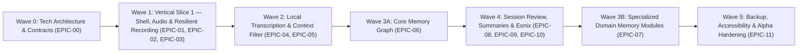

# Palantyr V1 — Initial Project Plan, EPICs & User Stories

> **Status**: Draft v1.0 (Aligned with Frozen PRD v1.0 - FINAL)  
> **Governance**: Aurora Agents House (`Nara` Strategy & Intent Lens -> `Kaede` Architecture Handoff -> `Usagi` Acceptance Traceability)  
> **Core Promise**: *The DM runs the game. Palantyr remembers it.*

---

## 1. Executive Strategy & Delivery Roadmap (Nara `ST` Lens)

### 1.1 Strategic Framing & Non-Goals
Palantyr V1 is a **Windows-first, offline-first Campaign Memory Keeper** for Dungeon Masters. Recording, transcription, context classification, summaries, review, and Eonix exist solely to build, protect, and retrieve **persistent Campaign Memory** without competing for system resources during live tabletop sessions.

- **Primary Priorities**:
  1. **Zero Session Loss**: Progressive recoverable audio recording and crash-safe persistence take priority over all background AI work (`NFR-REL-001`, `NFR-PERF-002`).
  2. **Non-Generative Epistemic Integrity**: Never invent campaign facts; separate *Conversation Context* (joke/table talk vs. canon candidate), *Extraction Confidence*, and *In-World Knowledge State* (`FR-CTX-009`, `FR-MEM-CONF-006`, `FR-MEM-KNOW-002`).
  3. **DM Authority & Low Review Burden**: Keep post-session review within 5–30 minutes by surfacing only continuity-critical ambiguities in *Needs Attention* (`FR-REV-001`, `FR-REV-007`).
  4. **Pre-Generation Privacy Filtering**: *Party Safe* outputs must filter out `DM Only` sources before generation, never by post-hoc redaction (`FR-SUM-003`, `NFR-PRIV-003`).
- **Frozen V1 Non-Goals (Deferred to V2+)**:
  - No automatic speaker diarization (`FR-TRN-005`).
  - No generative campaign/encounter authoring or internet-enabled Planning Dragon (`V2-CANDIDATE-002`).
  - No cloud sync, VTT/Discord integrations, multi-DM collaboration, or player companion apps (`Section 38`).

### 1.2 Phased Delivery Waves & First Vertical Slice

- **Wave 0 — Architecture & Technical Design Gate (`EPIC-00`)**: Resolve the 19 `TECH-DECISION` items and 5 `ARCH-CONSTRAINT` rules from PRD Section 41, enforcing per-campaign storage isolation (`US-11.1` foundation) and transcript-free diagnostic logging (`US-11.4` foundation) from day one.
- **Wave 1 — Recommended First Vertical Slice (`EPIC-01`, `EPIC-02`, `EPIC-03`)**: Campaign shell + First-run assessment + Settings + Microphone test + Segmented recoverable recording + Pause/Resume/End + Crash reopen/recovery (PRD Section 42 recommendation). *Note (`Nara Advisory 1`)*: `US-02.4` delivers plain/structured text lore entry and visibility tagging in Wave 1, activating spoken/AI-extracted lore in Wave 3A once `EPIC-04` and `EPIC-06` are live.
- **Wave 2 — Transcription & Canon Gatekeeper (`EPIC-04`, `EPIC-05`)**: Replaceable local transcription adapter (EN/ES), persistent queue, dual transcript preservation, and span-level Conversation Context classification.
- **Wave 3A — Core Campaign Memory Graph (`EPIC-06`)**: Universal entity model, knowledge states, confidence, entity resolution, conflict tracking, core entities (Characters, Locations, Journeys/Time), and direct Memory Browser/CRUD foundation.
- **Wave 4 — Human-in-the-Loop Validation, Summaries & Eonix (`EPIC-08`, `EPIC-09`, `EPIC-10`)**: Needs Attention conversational review, Full Review batches, correction propagation, Party-Safe vs. DM Summaries, and Talk to Eonix wired end-to-end against Core Memory first (`Nara Advisory 2`).
- **Wave 3B — Specialized Domain Memory Modules (`EPIC-07`)**: Expand extraction and domain tracking to Objects/Crafting, Organizations, Quests/Irrecoverable Loss, Social Events, Party Conversations, and Combat/Key Moments.
- **Wave 5 — Data Stewardship & Release Readiness (`EPIC-11`)**: Full campaign backup/restore UI, activity-aware reminders, accessibility baseline, schema migrations, and Alpha benchmark validation.

---

## 2. EPIC Overview Matrix

| Epic ID | Epic Name | Delivery Wave | Primary PRD Sections | Key Acceptance Criteria |
| :--- | :--- | :--- | :--- | :--- |
| **EPIC-00** | System Architecture, Contracts & Benchmark Harness | Wave 0 | Sec 35, 39, 41, 42 | `AC-MAINT-001..005`, `AC-PERF-001` |
| **EPIC-01** | First-Run Assessment, Settings & Adaptive Runtime | Wave 1 | Sec 6, 27, 29, 38, 39 | `AC-SYS-001`, `AC-PERF-001..003`, `AC-DATA-004` |
| **EPIC-02** | Campaign Management, Setup Wizard & Campaign Home | Wave 1 | Sec 15, 22, 28, 30, 38 | `AC-DATA-001`, `AC-DATA-006`, `AC-USAB-001`, `AC-USAB-003` |
| **EPIC-03** | Resilient Session Recording, Segmentation & Crash Recovery | Wave 1 | Sec 5, 28, 30, 31, 39 | `AC-REC-001..003`, `AC-END-001..002`, `AC-REL-002`, `AC-REL-004`, `AC-DATA-002` |
| **EPIC-04** | Local Transcription Pipeline & Replaceable Engine | Wave 2 | Sec 4.1, 5, 6, 35, 39 | `AC-TRN-001..002`, `AC-REL-001`, `AC-REL-003`, `AC-MAINT-001` |
| **EPIC-05** | Conversation Context Classification & Canon Filtering | Wave 2 | Sec 3.1, 4.2, 39, 40 | `AC-CTX-001..005` |
| **EPIC-06** | Universal Memory Engine, Entities, Time & Conflicts | Wave 3 | Sec 4.3, 8–12, 21, 24, 25 | `AC-MEM-001..003`, `AC-ENT-001..002`, `AC-TIME-001`, `AC-MEM-007` |
| **EPIC-07** | Domain Memory Modules (Objects, Orgs, Quests, Social, Combat, Lore) | Wave 3 | Sec 16, 17, 18, 19, 20, 22 | `AC-MEM-001`, `AC-QUEST-001` |
| **EPIC-08** | Session Summaries, Privacy Filtering & Correction Propagation | Wave 4 | Sec 4.2, 13, 26, 34 | `AC-SUM-001..002`, `AC-COR-001`, `AC-MAINT-004` |
| **EPIC-09** | Session Review, Validation & Needs Attention Workflow | Wave 4 | Sec 7, 23, 40 | `AC-REV-001..002`, `AC-ENT-001` |
| **EPIC-10** | Talk to Eonix — Grounded Retrieval, Teaching & Evidence | Wave 4 | Sec 13, 14, 32, 33 | `AC-EONIX-001..003`, `AC-USAB-002`, `AC-MEM-002` |
| **EPIC-11** | Backup/Restore, Migrations, Accessibility & Release Hardening | Wave 5 | Sec 37, 38, 39, 40 | `AC-DATA-003`, `AC-DATA-005..008`, `AC-PRIV-001..002`, `AC-USAB-004` |

---

## 3. Detailed EPICs & User Stories

### EPIC-00: System Architecture, Replaceable Contracts & Benchmark Harness
**Goal**: Lock down the technical decisions delegated by PRD Section 41 and establish provider-neutral domain contracts before feature implementation scales.

- **US-00.1: Windows Application Stack, Local Storage & Domain Schema Design**
  - *As a* system architect, *I want* a finalized ADR for the Windows desktop framework, local offline database/storage engine, and core schema, *so that* multi-hour sessions, graph-like relationships, temporal validity, and offline backups work reliably for a small team.
  - **Requirements**: `NFR-MAINT-002`, `NFR-PRIV-001`, `NFR-PRIV-005`, `TECH-DECISION` (App stack, DB schema, Memory representation, Retrieval architecture).
- **US-00.2: Provider-Neutral AI & Transcription Adapter Interfaces**
  - *As a* developer, *I want* internal Palantyr-owned contracts for Transcription, Context Classification, Memory Extraction, Embeddings, and Conversational LLM calls, *so that* engines (e.g., `faster-whisper`, `whisper.cpp`, `llama.cpp`, `Ollama`) can be upgraded or swapped without altering Campaign Memory schemas.
  - **Requirements**: `FR-TRN-006`, `NFR-MAINT-001`, `NFR-MAINT-004`, `NFR-MAINT-006`, `ARCH-CONSTRAINT-001`, `ARCH-CONSTRAINT-002`.
  - **Acceptance**: `AC-MAINT-001`, `AC-MAINT-002`.
- **US-00.3: Model, Prompt & Schema Lineage Tracking**
  - *As a* maintainer, *I want* every AI-derived artifact (Transcript segment, Context span, Memory record, Summary) to record the engine, model revision, adapter version, and prompt/schema version internally, *so that* outputs can be audited, reproduced, or rolled back without cluttering the normal DM UI.
  - **Requirements**: `FR-TRN-007`, `NFR-MAINT-003`, `NFR-MAINT-005`, `NFR-MAINT-007`, `ARCH-CONSTRAINT-003`, `ARCH-CONSTRAINT-004`.
  - **Acceptance**: `AC-MAINT-003`, `AC-MAINT-005`.
- **US-00.4: Deterministic Audio Replay & Benchmark Fixture Harness**
  - *As a* QA/performance engineer, *I want* a developer fixture runner that replays retained long-session audio across high-, mid-, and low-spec Windows PCs, *so that* CPU, GPU, RAM, VRAM, crash-recovery loss targets, and extraction accuracy can be measured deterministically.
  - **Requirements**: `NFR-PERF-004`, `NFR-PERF-005`, `ARCH-CONSTRAINT-005`.
  - **Acceptance**: `AC-PERF-001`.

---

### EPIC-01: First-Run System Assessment, Settings & Adaptive Runtime
**Goal**: Configure Palantyr automatically for the DM's hardware on first launch and protect active gameplay performance at all times.

- **US-01.1: First-Run Hardware & Audio Onboarding Assessment**
  - *As a* DM installing Palantyr for the first time, *I want* Palantyr to inspect my CPU, RAM, GPU/VRAM, available disk space, Windows version, and audio input devices (and run a brief benchmark when appropriate), *so that* it recommends a safe processing mode (`Live Balanced`, `Recording Only`, or `Manual/Deferred`) without requiring me to understand CUDA or quantization.
  - **Requirements**: `FR-SYS-001..005` (Sec 6 & Sec 27), `NFR-PERF-004`.
  - **Acceptance**: `AC-SYS-001`.
- **US-01.2: CPU Fallback & Re-runnable System Assessment**
  - *As a* DM without a dedicated GPU or who recently upgraded hardware/drivers, *I want* Palantyr to support a CPU-compatible recording/deferred-processing profile and allow re-running the assessment from Settings.
  - **Requirements**: `FR-SYS-002` (Sec 6), `FR-SYS-005` (Sec 27).
  - **Acceptance**: `AC-SYS-001`.
- **US-01.3: Active Session Priority Scheduler & Graceful Throttling**
  - *As a* DM running VTT, Discord, browser tabs, and music during play, *I want* Palantyr to enforce strict resource priority (`1. Recording & Audio Save` > `2. Active Eonix Query` > `3. Deferrable Background Processing`) and automatically throttle or pause background jobs under CPU/GPU/RAM/VRAM/disk pressure while explaining the change in Eonix's voice with clear technical facts.
  - **Requirements**: `FR-PERF-001`, `NFR-PERF-001..003`, `NFR-PERF-006..008`, `NFR-USAB-005`.
  - **Acceptance**: `AC-PERF-001`, `AC-PERF-002`.
- **US-01.4: Application Settings & Opt-In Original Audio Retention**
  - *As a* DM, *I want* a Settings screen to configure processing mode, pause-processing preference (`Never`, `Ask`, `Always`), microphone selection/testing, animation reduction, and an opt-in `Keep Original Session Audio` toggle (disabled by default with a disk-space warning and manual per-session audio deletion), *so that* I control storage and runtime behavior.
  - **Requirements**: `FR-PROC-003`, `NFR-DATA-006`, `NFR-USAB-009`, Sec 38 (`V1 REQUIRED - Settings`).
  - **Acceptance**: `AC-DATA-004`, `AC-USAB-004`.

---

### EPIC-02: Campaign Management, Guided Setup Wizard & Campaign Home
**Goal**: Provide the top-level navigation (`Loading -> Welcome -> Campaign Home`), guided campaign creation, initial party/lore setup, and an at-a-glance Campaign Home working surface.

- **US-02.1: Welcome Screen, Campaign Selection & Safe Campaign Deletion**
  - *As a* DM, *I want* to create, open, or delete campaigns from the Welcome screen, where deleting a campaign requires explicit confirmation and offers `Create Backup and Delete`, `Delete Without Backup`, or `Cancel`, *so that* a campaign is never lost by accident.
  - **Requirements**: Sec 28, Sec 38 (`Safe Campaign Deletion`), `NFR-DATA-010`, `NFR-USAB-008`.
  - **Acceptance**: `AC-DATA-001`, `AC-DATA-006`, `AC-USAB-003`.
- **US-02.2: Guided Create Campaign Wizard**
  - *As a* DM starting a campaign, *I want* a step-by-step wizard covering campaign basics, world info, calendar, initial party roster, optional world lore, audio/recording setup, and final review, *so that* setup is structured rather than one overwhelming form.
  - **Requirements**: Sec 28 (`Create Campaign`).
- **US-02.3: Party Roster & Historical Membership Management**
  - *As a* DM, *I want* to register player characters and temporary NPCs with player-vs-character separation, minimum attributes (name, race/species, class/archetype), and historical membership states (`Active`, `Temporary`, `Former`, `Deceased`, `Inactive`) tied to session/date context, *so that* Palantyr tracks party evolution without assuming every active member attends every scene.
  - **Requirements**: `FR-CAM-001..006`.
- **US-02.4: Optional Initial & Ongoing World Lore Ingestion (Text & Voice)**
  - *As a* DM, *I want* to input world lore during campaign setup or later via typed/pasted text or microphone narration, review extracted structured lore before confirming, and assign visibility (`General World`, `Party Knowledge`, or `DM Private`), *so that* Palantyr understands my setting from Session 1.
  - **Requirements**: `FR-SETUP-001..007`, `FR-MEM-LORE-001..003`.
- **US-02.5: Persistent Campaign Home & Explicit Subsystem Status Indicators**
  - *As a* DM, *I want* Campaign Home to serve as my single persistent workspace across `Idle`, `Recording`, and `Paused` states, showing Eonix's state alongside separate, non-color-only status indicators for `Recording/Audio Save`, `Transcription`, `Memory Processing`, and `Eonix/Query`, plus session timer, segment progress, and an actionable `Needs Attention` badge.
  - **Requirements**: `UX-CAM-001..003`, `UX-HOME-001..009`, `NFR-USAB-003`.
  - **Acceptance**: `AC-USAB-001`.

---

### EPIC-03: Resilient Session Recording, Segmentation & Crash Recovery
**Goal**: Guarantee that tabletop audio is captured safely across multi-hour sessions, segmented cleanly, protected against crashes or accidental window closure, and cleaned up only when all downstream dependencies are satisfied.

- **US-03.1: Pre-Session Microphone Validation & Progressive Disk Recording**
  - *As a* DM starting a session, *I want* Palantyr to verify that my selected microphone is available and receiving signal, and then write audio progressively to recoverable temporary disk storage rather than RAM, *so that* even a power loss preserves the vast majority of the active segment.
  - **Requirements**: `FR-REC-001`, `FR-REC-002`, `NFR-REL-001`, `NFR-REL-006`, `NFR-DATA-001`.
  - **Acceptance**: `AC-REC-001`.
- **US-03.2: Automatic ~15–20 Min Segmentation & Non-Blocking Pause/Resume**
  - *As a* DM, *I want* continuous recording to roll over into manageable segments (~15–20 minutes) and `Pause` to safely close the current segment (optionally triggering pause-time transcription per my preference) while `Resume` starts recording immediately without waiting for background jobs.
  - **Requirements**: `FR-REC-004`, `FR-REC-005`, `FR-PROC-002..004`.
  - **Acceptance**: `AC-REC-001`, `AC-REC-002`.
- **US-03.3: Two-Stage End Session & Independent Post-Session Processing Choice**
  - *As a* DM ending a session, *I want* `End Session` to require confirmation first, safely persist the final audio segment, transition the session permanently to `Ended`, display segment/processing stats, and let me choose `Continue Processing` or `Finish Later`.
  - **Requirements**: `UX-END-001..003`, `FR-END-001..004`, `FR-PROC-001`.
  - **Acceptance**: `AC-END-001`, `AC-END-002`.
- **US-03.4: Crash / Interruption Detection, Transparent Recovery & Storage Guard**
  - *As a* DM reopening Palantyr after a crash, power outage, or disk-space warning, *I want* Palantyr to monitor free storage during recording (warning before writes fail) and upon restart clearly report what segments were safe, what was recovered, and what could not be recovered, letting me inspect, continue, end, or close the recovered session.
  - **Requirements**: `FR-REC-006..008`, `NFR-REL-002`, `NFR-REL-005`, `NFR-DATA-003`.
  - **Acceptance**: `AC-REC-003`, `AC-DATA-002`, `AC-REL-002`.
- **US-03.5: Active Recording Exit Guard & Safe Temporary Audio Cleanup**
  - *As a* DM, *I want* Palantyr to intercept window close attempts during active recording (`End Session and Exit` vs. `Return to Session`) and only delete temporary audio after transcription, persistence, and post-session audio-context validation are complete (unless `Keep Original Session Audio` is enabled).
  - **Requirements**: `FR-REC-003`, `NFR-REL-009`, `NFR-DATA-002`.
  - **Acceptance**: `AC-REL-004`.

---

### EPIC-04: Local Transcription Pipeline & Persistent Queue
**Goal**: Transcribe recorded segments locally in English and Spanish with timestamps, incremental persistence, and preserved machine vs. corrected transcript layers.

- **US-04.1: Incremental Segment Transcription & Persistent Offline Queue**
  - *As a* DM, *I want* each closed audio segment to enter a persistent local transcription queue that saves completed transcript segments immediately and survives app restarts, *so that* multi-hour sessions never lose completed transcription work.
  - **Requirements**: `FR-TRN-001`, `FR-TRN-002`, `NFR-REL-003`, `NFR-PERF-006`.
  - **Acceptance**: `AC-TRN-001`, `AC-PERF-003`.
- **US-04.2: English & Spanish Transcription with Source Timestamps**
  - *As a* DM running campaigns in English or Spanish, *I want* accurate local transcription that preserves segment and utterance timestamps, *so that* Campaign Memory and Eonix can link back to exact session moments and 10-second audio clips.
  - **Requirements**: `FR-TRN-003`, `FR-TRN-004`, `FR-TRN-005`.
  - **Acceptance**: `AC-TRN-001`, `AC-EONIX-003`.
- **US-04.3: Dual Transcript Storage (Corrected View vs. Immutable Machine Original)**
  - *As a* DM, *I want* user-facing transcripts and evidence views to reflect confirmed spelling and semantic corrections while internally preserving the original machine transcript and engine/model version, *so that* provenance and reprocessing remain auditable.
  - **Requirements**: `FR-TRN-007`, `FR-COR-002`, `FR-EONIX-017`, `NFR-TRACE-002`.
  - **Acceptance**: `AC-TRN-002`.
- **US-04.4: Fault-Isolated & Idempotent Transcription Retry**
  - *As a* DM, *I want* any transcription failure to be isolated from recorded audio and existing Memory, report its probable cause clearly, and retry idempotently without duplicating transcript segments.
  - **Requirements**: `NFR-REL-004`, `NFR-REL-005`, `NFR-REL-007`.
  - **Acceptance**: `AC-REL-001`, `AC-REL-002`, `AC-REL-003`.

---

### EPIC-05: Conversation Context Classification & Canon Gatekeeper
**Goal**: Prevent table talk, out-of-character jokes, rules discussions, and hypotheticals from contaminating Campaign Memory while keeping the full transcript intact.

- **US-05.1: Utterance/Span-Level Context Classification**
  - *As a* DM, *I want* Palantyr to classify transcript spans within a mixed audio segment into `In-World / Canon Candidate`, `Out-of-Character / Table Talk`, `Hypothetical / Joke / What-if`, `Rules / Admin / Meta`, or `Ambiguous`, *so that* a single segment containing both roleplay and jokes is handled accurately at span granularity.
  - **Requirements**: `FR-CTX-001`, `FR-CTX-002`, `FR-CTX-009`.
  - **Acceptance**: `AC-CTX-002`, `AC-CTX-005`.
- **US-05.2: Default Non-Canon Filtering with Full Transcript Preservation**
  - *As a* DM, *I want* non-canon spans (`Table Talk`, `Joke/What-if`, `Rules/Meta`) to be excluded from Campaign Memory and Session Summary narration by default while remaining searchable in the permanent transcript.
  - **Requirements**: `FR-CTX-003..005`, `NFR-MEM-001`, `NFR-MEM-002`.
  - **Acceptance**: `AC-CTX-001`, `AC-CTX-005`.
- **US-05.3: Explicit Joke-to-Canon Transition Handling**
  - *As a* DM, *I want* Palantyr to recognize when a joke or hypothetical is explicitly established by the DM as campaign fact, extracting only the confirmed canonical portion into Campaign Memory while keeping the prior banter non-canon.
  - **Requirements**: `FR-CTX-006`.
  - **Acceptance**: `AC-CTX-003`.
- **US-05.4: Ambiguous Critical Context Routing & Rejection Provenance**
  - *As a* DM, *I want* continuity-critical spans with ambiguous canon status to be routed to `Needs Attention` as a natural conversational question from Eonix, and once resolved or rejected, retain provenance so re-processing never re-proposes a rejected joke as canon.
  - **Requirements**: `FR-CTX-007`, `FR-CTX-008`, `FR-CTX-010`, `UX-CTX-001`, `UX-CTX-002`.
  - **Acceptance**: `AC-CTX-004`, `AC-MEM-007`.

---

### EPIC-06: Universal Memory Engine, Core Entities, Time & Conflict Resolution
**Goal**: Build the core non-generative Campaign Memory graph that models entities, epistemic Knowledge States, extraction Confidence, flexible locations, relative time/journeys, entity resolution, and historical conflicts.

- **US-06.1: Universal Entity Model, Epistemic Knowledge States & Extraction Confidence**
  - *As a* DM, *I want* every Memory record to track Identity, Current/Historical State, Relationships, Time, Visibility (`Party` vs. `DM Private`), Provenance, orthogonal *Knowledge State* (`Campaign Truth`, `DM Private Truth`, `Party Belief`, `Player/Character Theory`, `Claim/Rumor`, `Unknown/Unresolved`, `Disproven/Superseded Belief`), and *Confidence* (`DM Confirmed`, `High`, `Medium`, `Low` + internal score) without inventing missing attributes.
  - **Requirements**: Sec 8, `FR-MEM-KNOW-001..004`, `FR-MEM-CONF-001..010`, `NFR-TRACE-001`.
  - **Acceptance**: `AC-MEM-001`, `AC-MEM-002`, `AC-MEM-003`.
- **US-06.2: Character Memory, Aliases, Titles & Recognition Variants**
  - *As a* DM, *I want* Character Memory to store race/species, description, traits, role, affiliations, evolving relationships, and distinguish statements *by* vs. *about* a character, while keeping internal speech-to-text recognition variants separate from in-world aliases and titles.
  - **Requirements**: Sec 9, `FR-MEM-CHAR-001`, `FR-MEM-CHAR-002`, `FR-VAL-006`.
  - **Acceptance**: `AC-ENT-001`.
- **US-06.3: Flexible Location Hierarchy & Transit Event Attribution**
  - *As a* DM, *I want* Locations to support arbitrary parent/child containment hierarchies (e.g., `World > Region > City > Tavern > Cellar`) and allow events occurring in transit between two places to be stored without falsely attributing them to either endpoint.
  - **Requirements**: `FR-MEM-LOC-001..003`.
- **US-06.4: Nested Events, Journeys, Relative Time & Day Transition Detection**
  - *As a* DM, *I want* Events (such as a 14-day journey or stay) to contain nested sub-events and Key Moments, supporting real session time, absolute campaign dates (only when established), and relative time (e.g., `Day 4 of Journey: Him Kuldir -> Great Mine`) detected from narrative markers without inventing false calendar precision.
  - **Requirements**: `FR-MEM-TIME-001..004`, `FR-MEM-EVT-001..003`, `FR-MEM-REL-001`.
  - **Acceptance**: `AC-TIME-001`.
- **US-06.5: Named Entity Resolution, No Auto-Merge & Retroactive Reference Repair**
  - *As a* DM, *I want* Palantyr to never auto-merge plausibly distinct named entities, present candidates (`Existing Entity`, `New Entity`, `Correct Name`, `Uncertain`) in the `Resolve ASAP` queue, learn recognition variants upon confirmation, and retroactively repair references across transcripts, summaries, and Memory.
  - **Requirements**: `FR-MEM-ENTITY-001..007`, `FR-VAL-001`, `FR-VAL-006`.
  - **Acceptance**: `AC-ENT-001`, `AC-ENT-002`.
- **US-06.6: Memory Conflict Detection & Historical Evolution Preservation**
  - *As a* DM, *I want* Palantyr to distinguish state changes over time and superseded beliefs from true contradictions, surface unresolved conflicts without deleting competing evidence, and disclose unresolved conflicts when answering affected questions.
  - **Requirements**: `FR-MEM-CONFLICT-001..007`.
- **US-06.7: Campaign Memory Browser & Direct Manual CRUD Surface**
  - *As a* DM browsing Campaign Memory from Campaign Home, *I want* to inspect, filter, manually create, or edit Memory entities, notes, visibility, and attributes through a shared authority and provenance pipeline with Eonix and Session Review, *so that* manual stewardship and conversational stewardship never diverge.
  - **Requirements**: `FR-MEM-DM-001`, `FR-MEM-DM-002`, `FR-MEM-DM-007`, `UX-HOME-008`, Sec 38 (`Campaign Memory browsing/editing`).

---

### EPIC-07: Specialized Domain Memory Modules
**Goal**: Capture deep tabletop domain semantics across Objects, Crafting, Organizations, Quests, Social Encounters, Party Conversations, and Combat.

- **US-07.1: Stateful Object Memory, Ownership/Possession & Modular Upgrades**
  - *As a* DM, *I want* Palantyr to track object identity, first encounter, separate ownership vs. possession history, container/storage nesting, commercial history (prices/offers/refusals), DM-hidden properties, system-agnostic state progressions (`Dormant -> Awakened`), chronological upgrades, installed components/gems, and derived upgrade counts.
  - **Requirements**: `FR-MEM-OBJ-001..014`.
  - **Acceptance**: `AC-MEM-001`.
- **US-07.2: Crafting Events, Material Consumption & Derived Calculations**
  - *As a* DM, *I want* Palantyr to record crafting events (primary crafter, assistants, quantities, recipes/blueprints), distinguish consumed materials from reusable tools and installed components, and distinguish observed quantities from rule-derived calculations while leaving missing data unknown.
  - **Requirements**: `FR-MEM-CRAFT-001..007`.
- **US-07.3: Organization, Faction, Cult & Group Memory**
  - *As a* DM, *I want* Palantyr to track organizations with first encounter, Party-known vs. DM-private structure/knowledge, optional review-time DM secret prompt, historical leadership and membership/rank changes, objectives, inter-faction relations, party standing history, and explicit-only alignment.
  - **Requirements**: `FR-MEM-ORG-001..011`.
- **US-07.4: Quest, Mission & Objective Continuity with Irrecoverable Loss Tracking**
  - *As a* DM, *I want* Palantyr to track quests and objectives (party or character-scoped, with or without an NPC giver), state transitions (`Discovered`, `Active`, `Blocked`, `Completed`, `Failed`, `Abandoned`), rewards, consequences, and preserve the distinction between the *original objective*, *completed/recovered quantities*, *irrecoverable loss events*, and *currently achievable goal*.
  - **Requirements**: `FR-MEM-QUEST-001..013`.
  - **Acceptance**: `AC-QUEST-001`.
- **US-07.5: Social Events, Statements, Promises & Character-Scoped Knowledge**
  - *As a* DM, *I want* NPC/world interactions stored as Social Events tracking participants, witnesses, discussed entities/topics, statements with speaker/audience/epistemic state (statement != proof of truth), decisions, promises/agreements, outcomes, and secrets revealed only to specific characters.
  - **Requirements**: `FR-MEM-SOC-001..008`.
- **US-07.6: Lightweight Party Conversation Indexing**
  - *As a* DM, *I want* meaningful PC-to-PC roleplay indexed into Party Conversation blocks (participants, topics, timestamp ranges, journey/location/day links) separately from Social Events so intra-party dialogue is retrievable without flooding the event list.
  - **Requirements**: `FR-MEM-CONV-001..005`.
- **US-07.7: Combat Events, Casualties, Final Blows & Key Combat Moments**
  - *As a* DM, *I want* each fight stored as a single Combat Event (actual participants, opponents, trigger, location/time, resolution, casualties, character death propagation, high-confidence final blows, linked loot) containing narrative *Key Combat Moments* that separate perceived risk/stakes before an action from its actual outcome.
  - **Requirements**: `FR-MEM-COMBAT-001..013`.

---

### EPIC-08: Session Summaries, Pre-Generation Privacy & Correction Propagation
**Goal**: Generate accurate narrative summaries, enforce strict `DM Only` vs. `Party Safe` isolation prior to generation, and propagate DM corrections across all layers.

- **US-08.1: Context-Aware Permanent Session Summary**
  - *As a* DM, *I want* Palantyr to generate a permanent narrative Session Summary after session processing that respects Conversation Context (excluding non-canon jokes/table talk) and links to causal events.
  - **Requirements**: Sec 4.2.
- **US-08.2: DM Summary vs. Party-Safe Summary with Strict Source Filtering**
  - *As a* DM, *I want* to generate either a `DM Summary` or a `Party Safe Summary` with clear UI mode labeling, where `Party Safe` filters out `DM Only` and ambiguous-visibility sources *before* generation so private secrets never leak directly, by paraphrase, or by inference.
  - **Requirements**: `FR-SUM-001..005`, `UX-SUM-001`, `NFR-PRIV-002`, `NFR-PRIV-003`.
  - **Acceptance**: `AC-SUM-001`, `AC-SUM-002`.
- **US-08.3: End-to-End Correction Propagation & Impact Review**
  - *As a* DM, *I want* my spelling and semantic corrections (from Session Review, Summary edits, Memory browser, or Talk to Eonix) to propagate across Campaign Memory, the user-facing corrected Transcript, Session Summary, entity references, and derived quantities/states, previewing affected records when a semantic change has wide impact.
  - **Requirements**: `FR-COR-001..005`, `FR-REV-013`, `FR-VAL-005`.
  - **Acceptance**: `AC-COR-001`.
- **US-08.4: Idempotent Reprocessing & DM Authority Preservation**
  - *As a* DM, *I want* any reprocessing of preserved transcripts (e.g., after a model or prompt upgrade) to never duplicate Memory records or overwrite my confirmed corrections, rejections, context rulings, entity merges, or visibility settings.
  - **Requirements**: `NFR-MEM-003`, `NFR-MAINT-008`.
  - **Acceptance**: `AC-MEM-007`, `AC-MAINT-004`.

---

### EPIC-09: Session Review, Validation & Needs Attention Workflow
**Goal**: Keep DM post-session review focused (5–30 minutes target), non-disruptive, conversational for critical ambiguities, and fast for batch confirmations.

- **US-09.1: Needs Attention Queue & Resolve ASAP Prioritization**
  - *As a* DM, *I want* Palantyr to populate `Needs Attention` strictly with continuity-critical uncertainties (unconfirmed first-time names, ambiguous identity merges, lore contradictions, unconfirmed quest acceptances, uncertain end-of-session party location, critical canon-vs-joke ambiguity) and prioritize identity/name items as `Resolve ASAP` during Pause or Review without ever interrupting live narration.
  - **Requirements**: `FR-REV-001`, `FR-REV-005..009`, `NFR-USAB-001`, `NFR-USAB-002`.
- **US-09.2: One-at-a-Time Conversational Needs Attention with Eonix**
  - *As a* DM, *I want* to resolve `Needs Attention` items one at a time ("one scroll at a time") via natural-language replies or quick candidate buttons with Eonix asking the minimum necessary questions, capturing any bonus facts I volunteer, and allowing me to defer or leave items `Unresolved`.
  - **Requirements**: `UX-REV-001`, `UX-REV-002`, `FR-REV-010..012`, `FR-VAL-003..005`.
  - **Acceptance**: `AC-REV-001`.
- **US-09.3: 10-Second Audio Context Playback During Review**
  - *As a* DM reviewing an uncertain name or low-confidence detection while temporary audio is still retained, *I want* to play ~10 seconds of audio around the timestamp to hear what was actually said at the table.
  - **Requirements**: `FR-VAL-002`.
- **US-09.4: Compact Batch Full Review (Yes/No, Follow-Up & Confirm All)**
  - *As a* DM opting into Full Review, *I want* Medium/High Confidence memories presented in compact chronicle pages with `Yes` (promotes to `DM Confirmed`), `No` (prompts whether to correct, mark false/never happened with rejection provenance, or mark unsure rather than silently deleting), and `Confirm All` for unresolved items on the page.
  - **Requirements**: `FR-REV-002`, `UX-REV-003..005`, `FR-REV-014..016`.
  - **Acceptance**: `AC-REV-002`.
- **US-09.5: Immediate Review Autosave, Review Later & Undo**
  - *As a* DM, *I want* every individual review decision saved immediately, the ability to `Review Later` and resume seamlessly on next launch, and an immediate `Undo` action for ordinary Memory confirmations, merges, or visibility changes.
  - **Requirements**: `FR-REV-003`, `FR-REV-004`, `NFR-REL-003`, `NFR-USAB-008`.
  - **Acceptance**: `AC-REV-001`, `AC-REV-002`.

---

### EPIC-10: Talk to Eonix — Grounded Retrieval, Conversational Teaching & Evidence View
**Goal**: Deliver the always-available, private text-only dragon memory keeper interface that retrieves grounded history, learns direct DM facts, and exposes source provenance on demand.

- **US-10.1: Always-Available Private Text Interface & Concise Personality**
  - *As a* DM, *I want* to chat with Eonix via text from Campaign Home while `Idle`, `Recording`, or `Paused` (never triggered by table audio and never speaking aloud), receiving concise answers by default that can be expanded or easily copied into external notes like OneNote.
  - **Requirements**: `UX-EONIX-001`, `UX-EONIX-002`, `UX-EONIX-005`, `UX-EONIX-006`, `FR-EONIX-001`, `FR-EONIX-010`, `NFR-USAB-006`.
  - **Acceptance**: `AC-EONIX-001`, `AC-USAB-002`.
- **US-10.2: Knowledge-Scope Grounded Retrieval & Honest "Unknown" Responses**
  - *As a* DM asking Eonix about characters, journeys, relationships, beliefs, or lore, *I want* Eonix to filter by requested scope (`DM/Campaign`, `Party Knowledge`, or specific character knowledge), refuse to invent facts when evidence is missing, and isolate any conversational reasoning from becoming Campaign Truth.
  - **Requirements**: `FR-EONIX-002`, `FR-EONIX-011..013`, `FR-MEM-KNOW-002`, `FR-MEM-KNOW-003`, Sec 14.
  - **Acceptance**: `AC-MEM-002`, `AC-EONIX-001`.
- **US-10.3: Epistemic & Confidence-Aware Natural Language**
  - *As a* DM, *I want* Eonix to phrase answers according to both *Confidence* (DM Confirmed vs. High clear memory vs. Medium tentative vs. Low blurry, only claiming "you told/confirmed" when provenance proves it) and *Knowledge State* (distinguishing Truth, Party Belief, Rumor, Theory, Superseded Belief, or unresolved conflicts), and answer "how sure are you?" with internal confidence scores and sources.
  - **Requirements**: `UX-MEM-001..003`, `FR-MEM-CONF-003..004`, `FR-MEM-CONF-009..010`, `FR-MEM-CONFLICT-006`.
  - **Acceptance**: `AC-MEM-003`.
- **US-10.4: Direct Conversational Teaching, Intent Clarification & DM Private Notes**
  - *As a* DM during play or prep, *I want* to teach Eonix new facts, relationships (creating minimal entities for newly mentioned names), or corrections via natural language, have Eonix ask before canonizing when my intent is ambiguous (established lore vs. future plan/idea), and store private `DM Notes / Plans` distinctly from Campaign Truth.
  - **Requirements**: `FR-MEM-DM-001..007`, `FR-EONIX-003..009`.
  - **Acceptance**: `AC-EONIX-002`.
- **US-10.5: On-Demand Evidence View & Timestamped Transcript Navigation**
  - *As a* DM asking where an answer came from, *I want* Eonix to open an Evidence View showing the source type, Session, timestamp, corrected transcript excerpt (with access to original machine text), confidence, and Knowledge State, with one-click navigation to that session transcript fragment.
  - **Requirements**: `FR-EONIX-014..017`, `UX-EONIX-003..004`, `UX-MEM-004`, `NFR-USAB-007`.
  - **Acceptance**: `AC-EONIX-003`.

---

### EPIC-11: Data Integrity, Campaign Backup/Restore, Accessibility & Release Hardening
**Goal**: Ensure long-term local data ownership, per-campaign backups, safe upgrades, diagnostic privacy, and accessibility compliance for the V1 release baseline.

- **US-11.1: Per-Campaign Backup & Restore with Optional Audio Inclusion**
  - *As a* DM, *I want* to create and restore per-campaign local backups (preserving Sessions, Transcripts, Summaries, Memory, review state, visibility, confidence, provenance, and DM corrections) that warn about private data and exclude retained audio by default unless I explicitly check `Include Retained Audio`.
  - **Requirements**: `NFR-DATA-005`, `NFR-DATA-007`, `NFR-DATA-008`, `NFR-DATA-011`, `NFR-PRIV-007`, `NFR-PRIV-008`.
  - **Acceptance**: `AC-DATA-003`, `AC-DATA-007`, `AC-PRIV-001`.
- **US-11.2: Activity-Aware Monthly Backup Reminder**
  - *As a* DM, *I want* Eonix to suggest a backup roughly once a month *only* when a campaign has accumulated meaningful changes (new sessions, Memory, or corrections) since the last backup, and never interrupt an active session.
  - **Requirements**: `NFR-DATA-009`.
  - **Acceptance**: `AC-DATA-005`.
- **US-11.3: Backward-Compatible Schema Migrations & Corruption Preservation**
  - *As a* DM upgrading Palantyr, *I want* existing campaigns to migrate safely without losing DM authority or Memory, and if data corruption is ever detected, preserve the corrupted state alongside recovery from the last known-good state/backup with transparent reporting.
  - **Requirements**: `NFR-REL-008`, `NFR-DATA-004`, `NFR-MAINT-009`.
  - **Acceptance**: `AC-DATA-008`.
- **US-11.4: Diagnostic Secret Minimization & Local-First Privacy Guard**
  - *As a* DM, *I want* standard logs and crash diagnostics to exclude full session transcripts and `DM Only` secrets by default, and guarantee that no campaign data leaves my machine unless an external path is explicitly enabled.
  - **Requirements**: `NFR-PRIV-004..006`.
  - **Acceptance**: `AC-PRIV-001`, `AC-PRIV-002`.
- **US-11.5: V1 Accessibility Baseline & Perpetual License Data Access**
  - *As a* DM, *I want* all core V1 views to be legible at 1080p with Windows display scaling, keyboard-accessible for primary text/forms, free of color-only critical status indicators, equipped with a `Reduce Animations` toggle, and guaranteed never to lock me out of local campaign access or critical data-safety patches when an update period expires.
  - **Requirements**: `NFR-USAB-009`, `NFR-DATA-011`, `NFR-SAFE-001`, Sec 37.
  - **Acceptance**: `AC-USAB-004`.

---

## 4. Confirmed Decision Checkpoint (`DC`) — Handoff to Kaede (`EPIC-00`)

The following baseline decisions have been confirmed by JP and lock the scope for **Kaede's System Architecture & Technical Design v0.1 (`EPIC-00`)**:
1. **Application Stack & Database (`US-00.1`)**:
   - **Backend & Host Runtime**: **.NET 10** (Windows-first, offline-first).
   - **Local Database**: **RavenDB Embedded** (per-campaign database isolation, native document revisions, Corax full-text search + native vector search, and native `.ravendbdump` per-campaign backup/restore, governed by strict active-session memory/indexing caps).
   - **Frontend UI**: **React + TypeScript** hosted in a lightweight native Windows desktop container (`.NET 10 + WebView2`).
2. **Bilingual Product Baseline (`FR-TRN-003`, UI & Eonix)**:
   - Full bilingual support for **English (`en`) and Spanish (`es`)** across Transcription, UI localization, Conversation Context classification, Memory extraction prompts, Summaries, and Eonix conversational interaction starting in Vertical Slice 1.
3. **Architecture Gate Authorized**:
   - Proceed with **Kaede (`MAP` / `ADR` / `ALT`)** on [PALANTYR_V1_ARCHITECTURE_AND_ADRS.md](file:///f:/PalantyrV2/docs/PALANTYR_V1_ARCHITECTURE_AND_ADRS.md).
