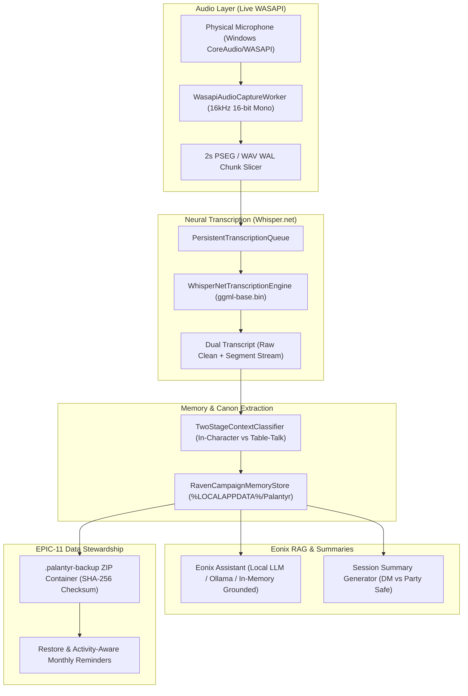

# Wave 5 Work-Unit Manifest (`MANIFEST-WAVE-05`)

> **Manifest ID**: `MANIFEST-WAVE-05`  
> **Target Scope**: Wave 5 — Live Hardware & Neural Engine Wiring (`LIVE-WIRING`) + Data Stewardship, Backup/Restore & Alpha Hardening (`EPIC-11`)  
> **Governing Lens**: Nara Midori (Intent & Truth) & Kaede (Architecture & Boundaries)  
> **Capacity Receipt**: `requested: 5` | `accepted: 5` | `active: 5` | `pending: 0`  
> **Reference Architecture**: [PALANTYR_V1_ARCHITECTURE_AND_ADRS.md](file:///F:/PalantyrV2/docs/PALANTYR_V1_ARCHITECTURE_AND_ADRS.md) (`ADR-001` through `ADR-009`)

---

## 1. Intent & Architectural Pivot

The user explicitly requested: **"Bond that wiring to the next wave 5"**.

Rather than finishing Wave 5 purely as a cosmetic data-backup and accessibility exercise over mock/synthetic generators, **Wave 5 now bridges the gap between simulated vertical slices and true physical table execution**:

---

## 2. Work Units Table

| Unit ID | Owner Role | Exclusive Owned Paths | Stories Covered | Acceptance Criteria | Stop Condition |
| :--- | :--- | :--- | :--- | :--- | :--- |
| `UNIT-W5-01` | Live WASAPI Microphone Capture Worker | `src/Palantyr.Audio/WasapiAudioCaptureWorker.cs`, `src/Palantyr.Audio/AudioRecordingEngine.cs`, `src/Palantyr.Contracts/AudioRecordingDtos.cs` | `US-03.1`, `US-03.2`, `US-01.3`, `FR-REC-001..005` | `AC-REC-001`, `AC-REC-002`, `AC-REC-003` | Replaces synthetic silence bytes with real Windows Audio Session API (WASAPI) capture streaming from the selected microphone device into 16kHz 16-bit mono PCM 2-second chunks. Graceful fallback to silence in test harnesses. No delegation. |
| `UNIT-W5-02` | Real Local Whisper Neural Engine Worker | `src/Palantyr.AI.Orchestration/WhisperNetTranscriptionEngine.cs`, `src/Palantyr.AI.Orchestration/ModelDownloadHelper.cs`, `src/Palantyr.Contracts/TranscriptionDtos.cs` | `US-04.1`, `US-04.2`, `US-04.3`, `FR-TRN-001..007` | `AC-TRN-001`, `AC-TRN-002`, `AC-REL-001` | Integrates `Whisper.net` with local GGML model files (e.g. `ggml-base.bin`, `ggml-small.bin`). Processes live WAV chunks into timestamped utterances with real acoustic neural inference and glossary injection. Preserves mock engine for hermetic test execution. No delegation. |
| `UNIT-W5-03` | Local LLM Connector & Grounded Prompting Worker | `src/Palantyr.AI.Orchestration/LocalLlmInferenceClient.cs`, `src/Palantyr.Domain/EonixAssistantService.cs`, `src/Palantyr.Domain/SessionSummaryService.cs` | `US-10.1`..`US-10.5`, `US-08.1`..`US-08.5` | `AC-EONIX-001..003`, `AC-SUM-001..002` | Adds pluggable local LLM integration (Ollama / OpenAI-compatible local loopback endpoint e.g. `http://127.0.0.1:11434/v1`) for natural narrative synthesis and Eonix conversation, keeping strict pre-generation visibility filtering and rule-based fallback when offline. No delegation. |
| `UNIT-W5-04` | Campaign Backup, Restore & Migrations Worker (`EPIC-11`) | `src/Palantyr.Contracts/BackupRestoreDtos.cs`, `src/Palantyr.Data.Raven/RavenCampaignMemoryStore.cs`, `src/Palantyr.Host/Program.cs` | `US-11.1`, `US-11.2`, `US-11.3`, `US-11.4` | `AC-DATA-003`, `AC-DATA-005`, `AC-DATA-007`, `AC-DATA-008`, `AC-PRIV-001..002` | Delivers `.palantyr-backup` ZIP export/import with SHA-256 verification, DM secret privacy notices (`NFR-PRIV-007`), optional audio retention toggle, monthly backup suggestion engine, and diagnostic secret scrubbing. No delegation. |
| `UNIT-W5-05` | UI Backup/Settings Modal, Accessibility & E2E Live Gate | `src/palantyr-ui/src/components/BackupRestoreModal.tsx`, `src/palantyr-ui/src/components/AccessibilitySettings.tsx`, `src/palantyr-ui/src/App.tsx`, `tests/Palantyr.UnitTests/Wave5Tests.cs` | Full Wave 5 & Live Table Gate | `AC-USAB-004`, `AC-DATA-003`, All Wave 5 Gates | Delivers UI modal for one-click backup export/restore, WCAG 2.1 AA accessibility toggles (Reduce Animations, high contrast, scaling), and comprehensive test suite proving live wiring and backup/restore roundtrips. No delegation. |

---

## 3. Acceptance Criteria & Quality Gates

1. **Hardware Audio Capture (`AC-REC-001`, `AC-REC-002`)**:
   - `WasapiAudioCaptureWorker` captures real 16 kHz 16-bit mono microphone input using Windows Multimedia / WASAPI.
   - Chunks are saved to disk in the 2-second WAV structure without missing buffers or audio distortion.
2. **Real Whisper Execution (`AC-TRN-001`, `AC-TRN-002`)**:
   - Given a real voice WAV file, `WhisperNetTranscriptionEngine` runs local neural inference and returns actual transcribed words.
   - Fantasy glossary words are injected into the Whisper initial prompt for domain term accuracy.
3. **Local LLM Inference with Grounding Guard (`AC-EONIX-001`, `AC-SUM-001`)**:
   - Eonix queries local LLM when available, injecting strictly filtered memory context according to DM vs Party visibility.
   - Retains rule-based fallback if no local LLM is running.
4. **Backup & Restore Roundtrip (`AC-DATA-003`, `AC-DATA-007`)**:
   - Exporting a campaign yields a `.palantyr-backup` ZIP container with manifest and SHA-256 checksums.
   - Restoring to a new campaign ID reproduces exact campaign state, memories, revisions, and sessions.
5. **Release Verification**:
   - All tests pass via `dotnet test F:\PalantyrV2\Palantyr.sln`.
   - UI compiles with 0 errors via `npm --prefix F:\PalantyrV2\src\palantyr-ui run build`.
